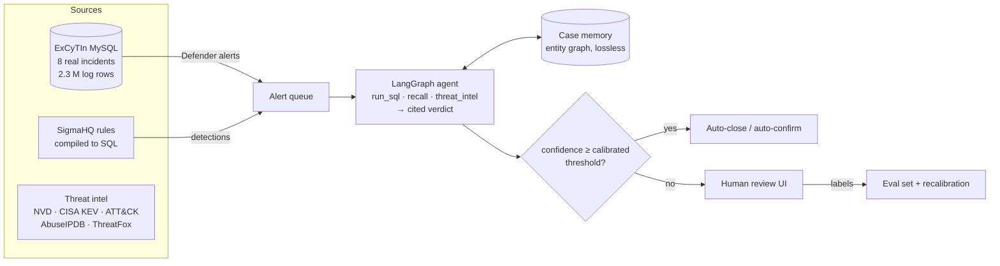

# SOC Triage Agent

[](https://github.com/Padma-Deepak/context-aware-threat-detection/actions/workflows/ci.yml)

An LLM agent that investigates security alerts the way a tier-2 analyst does: it queries real
Microsoft Sentinel / Defender XDR logs, checks threat intelligence, remembers what earlier cases found,
and returns a verdict in which **every claim cites the query that proves it**. It closes alerts on its
own only when a calibrated error guarantee holds; everything else goes to a human, whose decision
becomes training and evaluation data.

<!-- docs/demo.gif goes here after the first real run: see docs/DEPLOY.md -->

**Runs free on a laptop** with a local model (Ollama or LM Studio); OpenAI is optional and spend-capped.

## What it does



| Piece | What it is | Where |
|---|---|---|
| **Real data** | ExCyTIn-Bench (Microsoft, ICML 2026): 8 attack incidents from a real Azure tenant, 34-54 Sentinel/Defender tables each, 589 expert-graph questions | `triage/excytin/`, `docker-compose.excytin.yml` |
| **Detections** | A Sigma → SQL compiler for Defender tables. Compiles **1,680 of 1,734** SigmaHQ Windows rules (97%) in the mapped categories; refuses the rest with a reason instead of mistranslating. 23 SigmaHQ rules vendored; on the ransomware incident they fire on shadow-copy deletion, boot tampering and Mimikatz | `triage/sigma/` |
| **Agent** | LangGraph tool loop; read-only SQL (allow-list + SELECT-only DB user + timeout); Pydantic-validated verdict with per-claim evidence ids; bounded retries, step limit, prose fallback | `triage/agent.py`, `triage/triage_agent.py` |
| **Memory** | Lossless entity graph (IPs, hosts, accounts, SIDs, hashes, processes, URLs) built with regex + column hints, no LLM. Recall is guaranteed by test: any entity in any tool result is retrievable verbatim with its source row, even parts hidden by display truncation | `triage/memory.py` |
| **Escalation** | Conformal selective prediction (Learn-then-Test, Bonferroni over a fixed grid): auto-decide only above the threshold that keeps the error rate ≤ α with probability ≥ 1-δ | `triage/conformal.py` |
| **Threat intel** | NVD 2.0, CISA KEV, MITRE ATT&CK (free); AbuseIPDB, ThreatFox (free keys). Record/replay HTTP cache; private IPs are never sent out | `triage/intel/` |
| **Analyst UI** | Streamlit: queue, case view with cited findings, investigation timeline, entity graph, review form, metrics | `triage/ui/app.py` |
| **Interfaces** | CLI, MCP server (any MCP client can use the tools), Docker image | `triage/cli.py`, `triage/mcp_server.py` |
| **Engineering** | 160+ tests with a scripted model; LLM record/replay cassettes so CI needs no key; budget guard; OpenTelemetry tracing (Langfuse/Jaeger via OTLP); secret-scan test | `tests/`, `.github/` |

## Results

`gpt-oss:20b` running locally, temperature 0, **$0**. ExCyTIn questions asked in order within each incident, so
later questions can use what earlier ones found. Full report:
[results/excytin/main_report.md](results/excytin/main_report.md); raw runs without transcripts:
[main_slim.jsonl](results/excytin/main_slim.jsonl).

**Main run: 186 questions per mode (25 from each incident, 11 from the small one), 558 investigations, ~6.5 h.**

| Memory | Accuracy (95% CI) | Paired vs none (95% CI) | McNemar p | Tool calls | Input tokens | Sec |
|---|---|---|---|---|---|---|
| none | 38.2% (31-45) | | | 10.1 | 36.0k | 45 |
| full (replay everything) | 46.8% (40-54) | +8.6 (+0.5 to +16.1) | 0.048 | 3.8 | 78.1k | 25 |
| **graph** (this project) | 48.9% (42-56) | +10.8 (+2.7 to +18.8) | 0.013 | 9.6 | 39.3k | 55 |

**Graph vs full replay:** +2.2 points (95% CI −6.5 to +10.2), p = 0.71. **A tie on accuracy**; graph memory
used about half the input tokens (39k vs 78k) but took about twice as long per question.

What this does and does not show:

- **Memory helps.** Both memory modes are separable from no memory; graph more clearly (CI excludes 0 with
  room to spare, full only just).
- **Graph memory is not shown to be more accurate than simply replaying everything.** It matches it with half
  the input tokens, which matters when context is the cost. In the longest-running quarter of each chain
  (questions 19-25) accuracy was none 26%, full 45%, graph 50%, but the question order is a confound, so treat
  that as suggestive.
- **Graph mode is slower and cites worse:** 9.6 tool calls and 55 s per question versus 3.8 and 25 s for full;
  83% valid citations versus 90%; 8% of runs never called submit (full: 0%). It used `recall` on 87% of
  questions, and accuracy was 48% with recall versus 56% without (n = 161 vs 25; not meaningful).
- **Results vary a lot by incident** (graph: 73% on #38 but 16% on #55 and 32% on #166; one run per question).
  Transcript analysis ([docs/ERROR_ANALYSIS.md](docs/ERROR_ANALYSIS.md)) points to SQL schema errors: 31% of
  graph's queries fail (87% of those on a column that doesn't exist) versus 10% for full replay, which runs the
  agent out of steps. Graph runs with no SQL errors scored 77%. This is a correlation, not yet a tested cause.
- **Conformal escalation still automated 0%.** Confidence carries some signal (answers under 90 are right 16% of
  the time, 90 or more 57%, 95 or more 66%) but nowhere near the 90-95% reliability a 5-10% error target needs,
  so no threshold is certified and everything escalates. Agreement across repeated runs is the next thing to try.
- Numbers are answer accuracy, not ExCyTIn's published partial-credit reward, from a small local model, so they
  are not comparable to the published chart. Single run per question at temperature 0.
- An earlier 5-per-incident pilot ([pilot_report.md](results/excytin/pilot_report.md)) pointed the same way but
  was too small to separate the modes.
- Not yet run: prompt injection, triage on the alert queue, repeats for agreement-based confidence, any
  commercial model.

## Quickstart

```bash
uv venv -p 3.12 .venv && source .venv/bin/activate && uv pip install -r requirements-dev.txt
pytest -q                                   # no model, key or database needed
```

Full setup (data download, local model, benchmark, triage app): **[docs/EXCYTIN.md](docs/EXCYTIN.md)**.
The short version:

```bash
python -m triage.excytin.setup_db && EXCYTIN_DATA=~/excytin-data/data_anonymized/incidents \
  docker compose -f docker-compose.excytin.yml up -d
ollama pull gpt-oss:20b
python -m triage.excytin.run --memory none,graph --per-incident 25 --out results/excytin/main.jsonl
python -m triage.excytin.analyze results/excytin/main.jsonl
python -m triage.cli ingest && python -m triage.cli investigate --limit 40
streamlit run triage/ui/app.py
```

## Design decisions

- **Retrieve, never compress.** v1 of this project ([docs/V1_BENCHMARK.md](docs/V1_BENCHMARK.md)) compressed
  agent history with an LLM summary and could not show it was safe. Security work needs every
  identifier, so memory here is verbatim and indexed, and the agent asks for what it needs.
- **The model writes SQL, so the database cannot be trusted to the model.** Three independent guards:
  statement allow-list, a MySQL user with SELECT only (tested: DELETE is denied), server-side timeout.
- **Citations are checked, not trusted.** A claim citing an evidence id that no tool produced is flagged.
- **No calibration, no automation.** Until a threshold is calibrated on labelled cases, every alert
  escalates.
- **Labels are honest.** Defender alerts in a confirmed incident are labelled malicious. The dataset has no
  benign labels, so false-positive rate is reported only on reviewer-labelled alerts.
- **Free by default.** Local models; a response cache makes reruns and resumes free; paid calls stop at
  `TRIAGE_BUDGET_USD`.

## Limitations

- ExCyTIn is one tenant under simulated attack; alerts are mostly true positives. A real SOC's alert mix is
  dominated by false positives.
- The dataset's loader stripped backslashes from paths (upstream behaviour, kept for comparability), so
  Sigma path patterns are matched without them.
- ExCyTIn IPs are anonymised; external IP reputation mostly returns "not found" on this data.
- Accuracy here is answer accuracy; upstream's headline reward also gives partial credit for intermediate
  steps, so the numbers are not directly comparable to that reward.

## Repository

```
triage/            the agent, memory, conformal escalation, Sigma compiler, intel, case store, UI, CLI, MCP server
triage/excytin/    ExCyTIn loader, SQL tool, benchmark runner, grader, analysis, model bake-off
data/excytin/      ExCyTIn questions (MIT, vendored)
tests/             unit tests (scripted model) + live tests (-m excytin) + v1 tests
docs/              EXCYTIN.md runbook, DEPLOY.md, V1_BENCHMARK.md, EXPERIMENTS.md (v1)
agent/, mcp_server.py, data.py, db/, scenarios*.json    v1: the synthetic context-compression benchmark
```

## Credits

ExCyTIn-Bench: Wu et al., *ExCyTIn-Bench: Evaluating LLM agents on Cyber Threat Investigation*, ICML 2026
([code](https://github.com/microsoft/SecRL), MIT). Sigma rules: [SigmaHQ](https://github.com/SigmaHQ/sigma)
(DRL 1.1). Conformal selection: Angelopoulos et al., *Learn then Test*, 2021.
