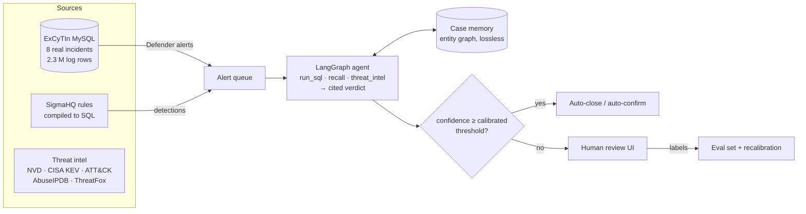

# SOC Triage Agent

[](https://github.com/Padma-Deepak/context-aware-threat-detection/actions/workflows/ci.yml)

An LLM agent that investigates security alerts the way a tier-2 analyst does: it queries real
Microsoft Sentinel / Defender XDR logs, checks threat intelligence, remembers what earlier cases found,
and returns a verdict in which **every claim cites the query that proves it**. It closes alerts on its
own only when a calibrated error guarantee holds; everything else goes to a human, whose decision
becomes training and evaluation data.

<!-- docs/demo.gif goes here after the first real run: see docs/DEPLOY.md -->

**Runs free on a laptop** with a local model (Ollama or LM Studio); OpenAI is optional and spend-capped.

## What it does



| Piece | What it is | Where |
|---|---|---|
| **Real data** | ExCyTIn-Bench (Microsoft, ICML 2026): 8 attack incidents from a real Azure tenant, 34-54 Sentinel/Defender tables each, 589 expert-graph questions | `triage/excytin/`, `docker-compose.excytin.yml` |
| **Detections** | A Sigma → SQL compiler for Defender tables. Compiles **1,680 of 1,734** SigmaHQ Windows rules (97%) in the mapped categories; refuses the rest with a reason instead of mistranslating. 23 SigmaHQ rules vendored; on the ransomware incident they fire on shadow-copy deletion, boot tampering and Mimikatz | `triage/sigma/` |
| **Agent** | LangGraph tool loop; read-only SQL (allow-list + SELECT-only DB user + timeout); Pydantic-validated verdict with per-claim evidence ids; bounded retries, step limit, prose fallback | `triage/agent.py`, `triage/triage_agent.py` |
| **Memory** | Lossless entity graph (IPs, hosts, accounts, SIDs, hashes, processes, URLs) built with regex + column hints, no LLM. Recall is guaranteed by test: any entity in any tool result is retrievable verbatim with its source row, even parts hidden by display truncation | `triage/memory.py` |
| **Escalation** | Conformal selective prediction (Learn-then-Test, Bonferroni over a fixed grid): auto-decide only above the threshold that keeps the error rate ≤ α with probability ≥ 1-δ | `triage/conformal.py` |
| **Threat intel** | NVD 2.0, CISA KEV, MITRE ATT&CK (free); AbuseIPDB, ThreatFox (free keys). Record/replay HTTP cache; private IPs are never sent out | `triage/intel/` |
| **Analyst UI** | Streamlit: queue, case view with cited findings, investigation timeline, entity graph, review form, metrics | `triage/ui/app.py` |
| **Interfaces** | CLI, MCP server (any MCP client can use the tools), Docker image | `triage/cli.py`, `triage/mcp_server.py` |
| **Engineering** | 160+ tests with a scripted model; LLM record/replay cassettes so CI needs no key; budget guard; OpenTelemetry tracing (Langfuse/Jaeger via OTLP); secret-scan test | `tests/`, `.github/` |

## Results

**Pilot only** (`gpt-oss:20b` locally, 5 questions from each of the 8 incidents = 40 per mode, temperature 0,
$0). Full report: [results/excytin/pilot_report.md](results/excytin/pilot_report.md); raw runs without
transcripts: [pilot_slim.jsonl](results/excytin/pilot_slim.jsonl).

| Memory | Accuracy (95% CI) | Paired vs none | McNemar p | Tool calls | Input tokens |
|---|---|---|---|---|---|
| none | 35.0% (20-50) | | | 10.6 | 30.6k |
| qa_notes (prior answers only) | 47.5% (32-62) | +12.5 (-5 to +30) | 0.27 | 9.0 | 29.4k |
| graph (this project) | 50.0% (35-65) | +15.0 (-0.1 to +32) | 0.15 | 9.3 | 33.7k |
| full (replay everything) | 60.0% (45-75) | +25.0 (+10 to +40) | 0.006 | 5.0 | 56.8k |

What this does and does not show:

- Only `full` is distinguishable from no memory, and `graph` is not distinguishable from `full`, `qa_notes`
  or `none` at n=40. **The pilot does not show that graph memory beats simple replay.**
- Chains here are only 5 questions long, which is the best case for `full`: everything still fits. The
  designed test is longer chains (25 per incident), where full replay overflows its budget and graph
  memory should hold up. That run has not been done.
- Graph mode used `recall` on 75% of questions and took 9.3 tool calls and 54 s per question versus 5.0 and
  22 s for `full`. Its citation validity was 82.5% (the model sometimes cites a question id instead of an
  evidence id), against 97.5% for `full`.
- **Conformal escalation could not automate anything.** The model reports 90-99 confidence on 108 of 160
  answers but is right 62% of those times, so no threshold meets a 5-20% error target and everything
  escalates. That is the guarantee working as designed, and it shows self-reported confidence from this
  model is unusable. Agreement across repeated runs is the next thing to try.
- Not yet run: the 25-per-incident main benchmark, prompt injection, triage on the alert queue, and any
  commercial-model check.

## Quickstart

```bash
uv venv -p 3.12 .venv && source .venv/bin/activate && uv pip install -r requirements-dev.txt
pytest -q                                   # no model, key or database needed
```

Full setup (data download, local model, benchmark, triage app): **[docs/EXCYTIN.md](docs/EXCYTIN.md)**.
The short version:

```bash
python -m triage.excytin.setup_db && EXCYTIN_DATA=~/excytin-data/data_anonymized/incidents \
  docker compose -f docker-compose.excytin.yml up -d
ollama pull gpt-oss:20b
python -m triage.excytin.run --memory none,graph --per-incident 25 --out results/excytin/main.jsonl
python -m triage.excytin.analyze results/excytin/main.jsonl
python -m triage.cli ingest && python -m triage.cli investigate --limit 40
streamlit run triage/ui/app.py
```

## Design decisions

- **Retrieve, never compress.** v1 of this project ([docs/V1_BENCHMARK.md](docs/V1_BENCHMARK.md)) compressed
  agent history with an LLM summary and could not show it was safe. Security work needs every
  identifier, so memory here is verbatim and indexed, and the agent asks for what it needs.
- **The model writes SQL, so the database cannot be trusted to the model.** Three independent guards:
  statement allow-list, a MySQL user with SELECT only (tested: DELETE is denied), server-side timeout.
- **Citations are checked, not trusted.** A claim citing an evidence id that no tool produced is flagged.
- **No calibration, no automation.** Until a threshold is calibrated on labelled cases, every alert
  escalates.
- **Labels are honest.** Defender alerts in a confirmed incident are labelled malicious. The dataset has no
  benign labels, so false-positive rate is reported only on reviewer-labelled alerts.
- **Free by default.** Local models; a response cache makes reruns and resumes free; paid calls stop at
  `TRIAGE_BUDGET_USD`.

## Limitations

- ExCyTIn is one tenant under simulated attack; alerts are mostly true positives. A real SOC's alert mix is
  dominated by false positives.
- The dataset's loader stripped backslashes from paths (upstream behaviour, kept for comparability), so
  Sigma path patterns are matched without them.
- ExCyTIn IPs are anonymised; external IP reputation mostly returns "not found" on this data.
- Accuracy here is answer accuracy; upstream's headline reward also gives partial credit for intermediate
  steps, so the numbers are not directly comparable to that reward.

## Repository

```
triage/            the agent, memory, conformal escalation, Sigma compiler, intel, case store, UI, CLI, MCP server
triage/excytin/    ExCyTIn loader, SQL tool, benchmark runner, grader, analysis, model bake-off
data/excytin/      ExCyTIn questions (MIT, vendored)
tests/             unit tests (scripted model) + live tests (-m excytin) + v1 tests
docs/              EXCYTIN.md runbook, DEPLOY.md, V1_BENCHMARK.md, EXPERIMENTS.md (v1)
agent/, mcp_server.py, data.py, db/, scenarios*.json    v1: the synthetic context-compression benchmark
```

## Credits

ExCyTIn-Bench: Wu et al., *ExCyTIn-Bench: Evaluating LLM agents on Cyber Threat Investigation*, ICML 2026
([code](https://github.com/microsoft/SecRL), MIT). Sigma rules: [SigmaHQ](https://github.com/SigmaHQ/sigma)
(DRL 1.1). Conformal selection: Angelopoulos et al., *Learn then Test*, 2021.
